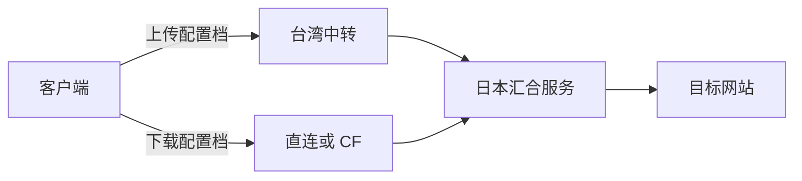

# PUK Bond：独立双通道会话模块

上传选一个配置档，下载选另一个。配置档可以是 sing-box 出站、selector、带 detour 的链，
或独立 SOCKS/HTTP 桥。两路都到达同一个 `puk-bond` 汇合服务，再共用一条网站 TCP 连接。
原生 sing-box 出站类型为 `puk-bond`，不依赖 Xray 或 XHTTP。



出口 IP 相同只是必要条件之一：必须进入同一汇合进程。两个独立进程即使共用公网 IP 和密钥，
也不会共享会话。负载均衡需将同一会话的两路送到同一实例；当前版本未实现跨实例会话共享。

## 客户端选择

运行 `puk-bond ui`，打开终端显示的本地链接；或者打开离线 `PUK-Bond-Editor.html`。
离线页内置相同的 Go/WASM 配置编译器，不依赖 CDN，不上传配置。

1. 导入自己的模块库，或导入现有 **sing-box JSON**。
2. 新增配置档：给它指定汇合服务地址、已有出站、可选 TLS 名称和证书指纹。
3. 选择上传、下载配置档。代理链面板可设置节点的前置节点，循环引用会被拒绝。
4. 保存模块库，导出客户端配置及汇合服务配置。两种文件含凭据，均留在本地。

常见配置档：

| 配置档 | 汇合地址 | 选用的出站 |
| --- | --- | --- |
| 上传台湾→日本 | `tcp://127.0.0.1:18085` | 日本代理，`detour` 台湾代理 |
| 下载日本 HY2 | `tcp://127.0.0.1:18085` | 日本 HY2 |
| 日本 TLS 直连 | `tls://jp.example.org:18443` | 留空 |
| CF 直达汇合服务 | `wss://upload.example.org/puk-bond` | 留空或前置节点 |
| 现有 CF WS 代理 | `tcp://127.0.0.1:18085` | 现有 CF WS 出站 |

表中的回环地址相对于**最后一个代理服务器**；例如最后一个代理在日本，则需让它能访问
日本本机的汇合端口。CF 不只一种接法：可使用原有代理配置档，也可使用模块的独立 WS 适配器。
服务器名称、路径、地址均由用户填写，示例域名及文档网段没有实际服务。

当前选择在生成配置、应用配置时生效。已有 sing-box selector 可继续运行时选节点；
不会把已建立的网站连接无缝迁移到新线路，也没有承诺断线续传。

## 构建及启动

```sh
# 原生内核（仓库根目录）
go build -tags with_quic,with_utls -o sing-box ./cmd/sing-box
# 独立工具（puk 模块目录）
cd puk
go build -o puk-bond ./cmd/puk-bond
./puk-bond init --out-dir /private/new-profile
./puk-bond ui
./puk-bond run --config /private/library.private.json --core /absolute/path/sing-box
```

`init` 为本地文件生成新的 256 位密钥；不要使用公开示例中的占位密钥。
`run` 先执行内核 `check`，使用私有临时配置，Ctrl+C 仅停止自己创建的内核。
默认导出的本地入口是 `127.0.0.1:19080`；不自动设置系统代理或 TUN。
如已经在 Throne 等客户端运行选中的配置档，可将其 SOCKS/HTTP 入口写入路径的 `chain`，
使用 `puk-bond bridge --config FILE`，不必启动第二个代理内核。
导出原生配置时请将链表达为 sing-box `detour`；外部 `chain` 为 CLI 桥接模式使用。

Android 构建在固定的 SFA 子模块上叠加本仓库 `android/` 中的薄界面，包名独立为
`io.nekohasekai.sfa.puk`，arm64、最低 Android 10。选择后点“应用到本机代理”，
由 SFA 确认导入，之后使用其 VPN 界面连接。底层仍由 SFA 管理 `VpnService`、TUN 和套接字保护。
构建包属于实验版，真机连接状态以 [验证记录](VERIFICATION.md) 为准。

## 与官方 s-ui 并行部署

s-ui 现有的 HY2、Reality、WS 入站可以继续提供通道。额外部署一个本模块汇合服务即可，
无需让面板理解新协议，也不覆盖面板数据库和已有入站。服务端同样支持独立出口 SOCKS/HTTP 链。

```sh
install -m 755 puk-bond-linux-amd64 /usr/local/bin/puk-bond
install -d -m 700 /etc/puk-bond
install -m 600 server.private.json /etc/puk-bond/server.json
install -m 644 puk-bond.service /etc/systemd/system/puk-bond.service
systemctl daemon-reload
systemctl enable --now puk-bond
```

导出的服务端文件是新服务模板；已有汇合服务应合并 `users`，保留其他用户及既有设置。

默认两个入口：TCP `127.0.0.1:18085`，WS `127.0.0.1:18086/puk-bond`。
CF Tunnel 可将一个自选域名映射到 `http://127.0.0.1:18086`；客户端选相应的 `wss://` URL。
HY2/Reality 通道直接连接最终 VPS 的回环 TCP 入口。
如需公网直接接入，在服务端 JSON 填 `certificate`、`key`，把 `listen` 改为公网监听地址和空闲端口；
客户端使用 `tls://`。自签证书需要正确 SAN、有效期，以及客户端对应的证书 DER SHA-256 指纹。
不会默认跳过服务端身份验证，也不会自动修改防火墙、CF Tunnel 或重启 s-ui。

## 协议与边界

每条网站连接生成随机会话 ID，两路分别用 HMAC-SHA256 认证角色、目标、时间、用户和汇合服务 ID。
服务端拒绝重放、重复角色、异目标配对；任一路缺失会超时清理。两路认证成功后只创建一条目标连接。
TCP/TLS 与 WS 只是承载适配，普通网站 TLS 仍由应用到网站端到端建立。

当前为每网站连接两条承载流，不是连接池或多路复用协议。支持 TCP 半关闭、有界帧和流量背压。
数据面上传写上行、下载读下行；外层 TLS、QUIC、WS 的握手和控制仍有双向流量。
原生 UDP 数据报尚未实现，内核会明确报错；HY2 作为 TCP 流通道已经可以使用。
故障会关闭会话，未实现透明恢复、跨实例状态共享或移动网络无缝切换。

公开仓库仅放通用程序、占位示例及构建脚本；用户文件默认使用 `.private.json` 命名且被忽略。
请在仓库外保存实际订阅、密钥、证书私钥和导入链接。代码遵循仓库根目录许可证。
